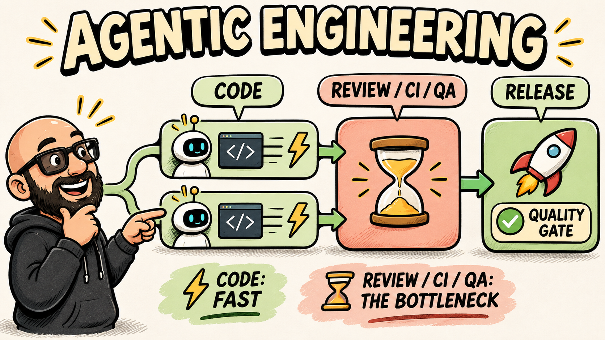
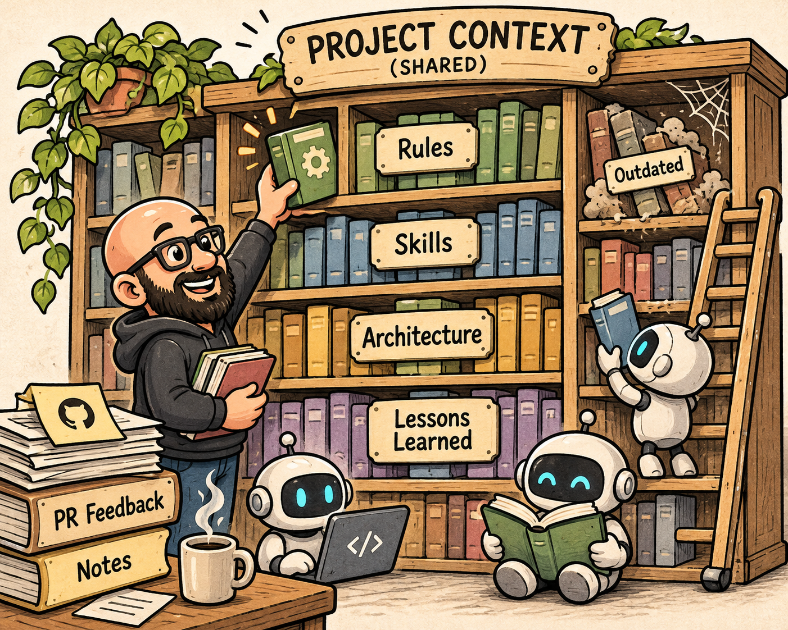
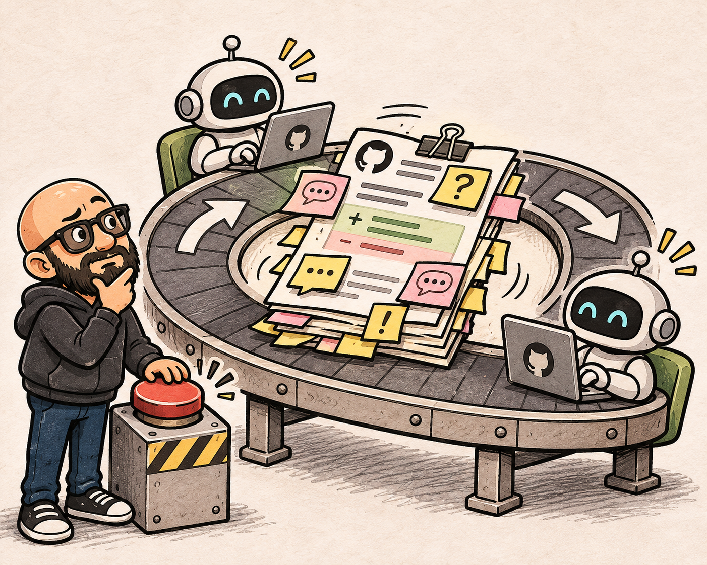
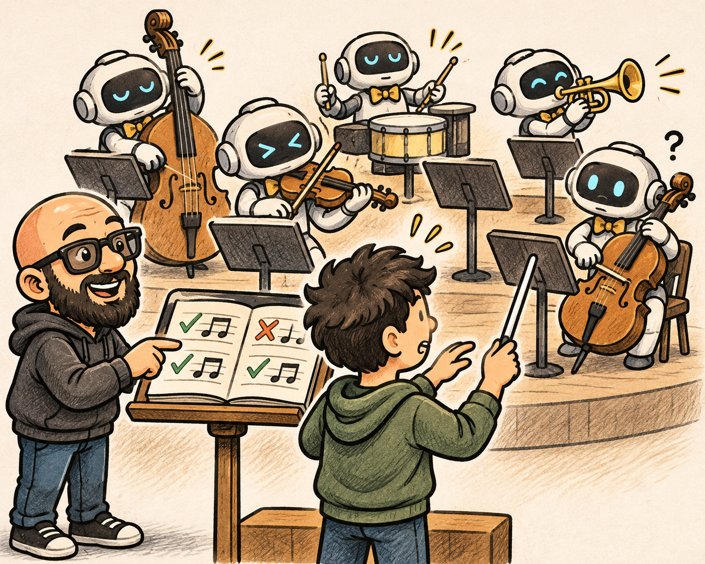
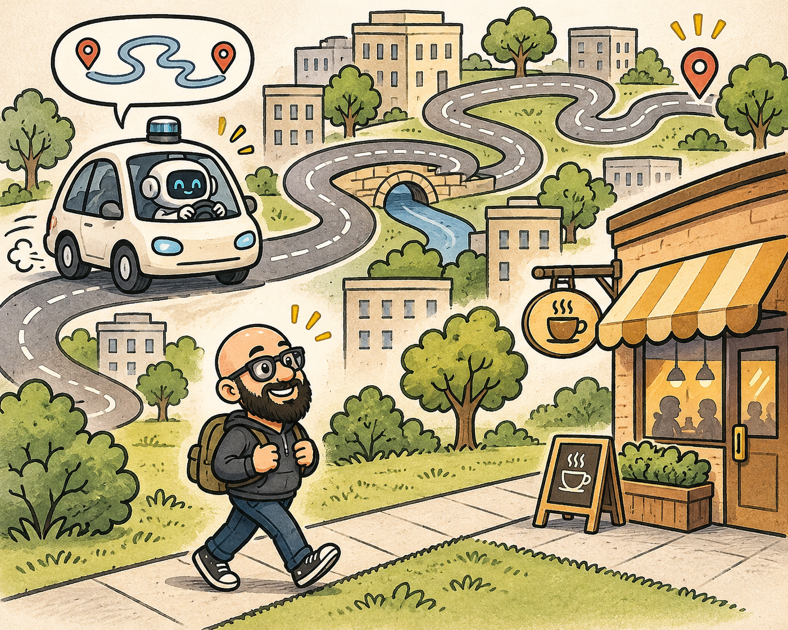

{width=600px fig-align="center"}

We've had to slow down opening new pull requests just to catch up on reviewing the ones already in progress.

It's a strange problem to have. Our team can spin up multiple coding agents working in isolated worktrees, implementing changes and opening PRs at a pace that would have been difficult to imagine a couple of years ago. Yet those PRs still have to make their way through code review, CI, and release QA. Sometimes the agents are producing work faster than we can absorb it, and sometimes that means deliberately slowing down the work we're starting so we can finish the work we've already started.

This is one of several problems I've been grappling with while leading an engineering team that increasingly relies on AI coding agents. We've developed some practices that work well, and plenty that we're still reconsidering. More than anything, the experience is changing how I think about the skills engineers need and how to develop them.

## Vibe coding vs agentic engineering

Before expounding on how we're building an agentic engineering team, I want to clarify what I mean by agentic engineering and how it's different from vibe coding. I've found it useful to distinguish between vibe coding and agentic engineering using the analogy of a self-driving car.

Vibe coding is like getting into a self-driving car knowing generally where you want to go, but not knowing how to drive yourself. You trust the car to get you there. You might even recognize when you've arrived at the wrong destination, but you probably don't have the experience to understand why something went wrong or how to correct it.

Agentic engineering is more like an experienced driver using the same car. You know how to drive, understand the route, and have opinions about how to reach your destination. You also recognize where the automation will outperform you, like navigating real-time traffic conditions or instantaneously reacting to a sudden hazard. You know when to let the car handle things and when to take the wheel.

I originally thought about this distinction mostly in terms of being able to intervene when an agent makes a mistake. But in practice, the most important interventions are frequently about setting direction in the first place.

Take something as ordinary as implementing a GitHub issue. We might have a perfectly reasonable specification with acceptance criteria and a proposed implementation. Once the agent starts investigating, it may uncover an assumption that doesn't hold, an interdependency that wasn't considered, or an opportunity to solve the problem more broadly. Sometimes the opposite happens and we discover that the scope is unnecessarily ambitious. I might ask the agent to investigate several possible approaches, tell it what evidence I want to see, and then decide which direction to pursue based on what it finds.

The agent does the investigation, updates the specification, implements the change, and verifies the result. My involvement is increasingly focused on shaping the intent of that work and evaluating the proposed approach. I spend a lot of time thinking about how to establish what "good" looks like before an agent even starts working, because if I haven't figured that out myself, I'm probably not going to be particularly effective at directing the agent toward it.

There is still a great deal of engineering involved, even if I'm not personally always writing the code.

For more on the distinction between vibe coding and agentic engineering, check out [this post](https://www.mindstudio.ai/blog/vibe-coding-vs-agentic-engineering-karpathy-framework). I especially like the quote about how [Karpathy](https://en.wikipedia.org/wiki/Andrej_Karpathy) frames the difference:

> Karpathy draws a hard line: vibe coding raises the floor for beginners; agentic engineering raises the ceiling for professionals.

## Curating the context around the code

{width=600px fig-align="center"}

One of our larger investments has been building and maintaining a shared context layer for the repository. We have project-wide rules, specialized agent skills, architectural documentation, and conventions for how work gets done. Our skills cover common workflows like creating GitHub issues, opening an isolated worktree for an issue, conducting code reviews, and triaging review feedback.

The rules themselves range from mundane to fairly sophisticated. For instance, we have rules for line wrapping when writing issues and pull requests. This corrects some default agent behavior that makes the output harder for humans to review. We also have guidance for sharing data between worktrees and specific expectations for reviewing dbt models or ingestion parsers.

I've developed a habit of promoting guidance from my personal agent memory into project rules when it becomes clear that the guidance should apply to everyone. Sometimes I recognize the opportunity myself. Other times, I'll have an agent examine its memories or look through comments on past PRs for recurring themes.

A good example is our code review process. If we keep seeing the same kind of feedback about how a dbt model should be structured or how a parser should handle a particular scenario, we have to decide whether the problem is with the implementation or with the guidance we're giving agents. If the same problem is being corrected over and over again, there's a reasonable chance we're missing something in our shared context.

I also think there's a subtle distinction between personal agent memory and project context that becomes important when you're working on a team. An engineer's personal agent may accumulate a tremendous amount of useful information through repeated interactions. But unless that information finds its way into something shared, the team ends up with different expectations and different development practices depending on who's directing the agent. That's not entirely new, of course. Engineers have always had their own preferences and habits. The difference is that agents can reproduce those individual habits across a much larger amount of work.

Over time, we've started treating the context surrounding the repository as something that needs the same kind of attention as the repository itself.

And we've already made some mistakes there.

We initially developed specialized code review skills for different parts of the codebase, including our dbt models and ingestion parsers. The idea was to provide more focused reviews than the general-purpose capabilities of the coding tools. As those built-in capabilities improved, though, our custom skills began to drift away from them.

We found ourselves adding increasingly specific instructions to correct how reviews were delivered. Sometimes the agent would identify a legitimate problem but fail to provide useful inline feedback. Other times, it would give suggestions in a format that wasn't particularly helpful or make claims about factual correctness without doing the investigation we expected.

We responded by adding more guidance, which worked well enough for a while. But eventually we had to ask whether we were maintaining these skills because they were genuinely better than the defaults or because we'd invested so much in them that we kept trying to make them work.

We've now scoped out development work to reconsider those skills based on what we've learned about the review process and the developer experience we want. I suspect we'll find opportunities to simplify some things and make others more specialized.

It's tempting to keep adding instructions whenever an agent does something wrong. I've certainly done plenty of that. But the accumulated instructions can eventually become part of the problem, especially as the underlying tools change.

### Onboarding through the context layer

We recently onboarded a new engineer, and this gave us an opportunity to test how well our context infrastructure could transfer knowledge to someone unfamiliar with the repository.

Our codebase had grown large enough that expecting someone to explore and internalize everything on their own seemed unreasonable. We also didn't want to simply hand over a pile of documentation and hope the new teammate would know which parts were important.

We started by examining patterns in how our existing engineers worked with the codebase. We looked at frequently used agent skills, important project rules, and how the repository was organized. From that, we built an agent-driven onboarding guide with a tutorial-style prompt that launched an interactive teaching session. It walked the new teammate through setting up their development environment, introduced a few preselected issues designed to teach our workflows, and showed them how to ask questions about the repository using our existing context infrastructure.

One of the more useful things that came out of this was discovering how much knowledge we still hadn't captured. There were things that seemed obvious to the existing team because we'd been working with the codebase for so long, but which weren't documented anywhere useful. We encouraged the new engineer to contribute documentation as those gaps became apparent.

In retrospect, that probably should have been an explicit goal of the onboarding process from the start. Having someone unfamiliar with the project try to navigate it is a pretty good way to learn what you've failed to explain.

We use code review as part of the learning process as well. One of our skills helps engineers triage review feedback, guiding them through decisions about when to fix something in place, apply feedback more broadly, defer an out-of-scope concern into a separate issue, or decline a suggestion with an explanation.

That last option is important. Not every review comment is correct, and not every valid observation should result in a change to the current PR. Sometimes a review identifies a legitimate problem that's outside the scope of what we're trying to accomplish. In those cases, we want to capture the issue so it isn't forgotten, while still allowing the original work to move forward.

There's a judgment call involved in all of this, and I want engineers to become comfortable making those decisions themselves rather than automatically accepting whatever the reviewing agent suggests.

We also maintain daily standups for prioritization and direct communication, along with a Slack channel dedicated to sharing things we've learned, which we call TIL, or Today I Learned. As our development workflows have become more asynchronous, I've been emphasizing proactive communication between teammates, particularly when work needs to be handed off.

It's easy to underestimate how much information used to be exchanged simply because engineers needed to collaborate directly on implementation. When people can make progress independently with agents, some of those conversations stop happening naturally. We have to be more deliberate about sharing what we're learning and communicating changes in direction.

## When the backlog starts to rot

We've spent considerable effort developing standards for writing good GitHub issues. We use templates for different issue types, with rules for categorization, acceptance criteria, implementation guidance, and explicitly documenting what is out of scope.

Agents help write those issues, and we also use them to capture follow-up work discovered during implementation or code review.

However, the backlog grows fast. That was true before we started using coding agents, but the pace is different now. It's easy to identify a problem and have an agent turn it into a reasonably detailed issue while you're working on something else. There isn't much friction involved in creating the issue, even if nobody has the capacity to work on it anytime soon.

And this is where we've been running into problems.

The codebase may change considerably before anyone gets around to implementing an issue. We encounter issues whose implementation details no longer make sense, duplicate work that was captured through separate investigations, and related issues that probably should have been considered together. Sometimes an issue describes a problem that has already been addressed indirectly through another change, but that connection wasn't obvious enough for anyone to close the original issue.

This isn't an entirely new problem. Backlogs have always suffered from neglect, and every engineering team has experienced the frustration of picking up an old ticket only to discover that much of its context is no longer relevant.

What feels different now is how quickly that happens. We can generate issues faster, but we can also change the codebase faster. An issue that would previously have remained relevant for months might now need substantial reconsideration after only a few weeks (or even days!).

We have a GitHub project where we manage priorities, deadlines, categorization, and assignments, but keeping the backlog useful requires regular attention. One safeguard we've built into our workflow is a human approval step when opening a fix for an issue. The agent investigates the issue and proposes an implementation plan, which the engineer reviews before authorizing the work.

I frequently use this as an opportunity to redirect the approach or correct assumptions that may no longer hold. If that changes the scope or acceptance criteria, we update the issue itself so the PR remains aligned with the specification.

We've also been experimenting with periodic backlog reviews, agent-assisted searches for duplicates or deprecated issues, and organizing more work into epics. We have a daily task that can automatically start work on simple open bugs.

There are other approaches we're considering, including [GitHub Agentic Workflows](https://github.github.com/gh-aw/) and more automatic assignment of issues directly to agents. We're also looking at updating our issue creation and implementation skills to check for duplicate work and reconcile old specifications against the current repository.

I wouldn't claim we've solved backlog management. We have a growing collection of practices that help, but they still require more attention than I'd like.

And I have some hesitation about simply automating our way out of the problem. If we automatically assign more issues to agents, they'll undoubtedly produce more implementations. But if those implementations turn into PRs that wait days for review, we haven't accomplished much. We've just moved the backlog from one part of the development process to another, which is something we've already experienced plenty of times.

## The bottlenecks move downstream

Our [CI/CD](https://github.com/resources/articles/ci-cd) system has become increasingly sophisticated as we've invested in quality assurance. We have extensive [dbt testing](https://docs.getdbt.com/docs/build/data-tests?version=2) and [data diffing](https://docs.datafold.com/data-diff/what-is-data-diff) in our workflows, with some checks taking 15 to 30 minutes to complete.

That runtime isn't inherently unreasonable given the work involved. But consider what happens when you have dozens of open pull requests, each potentially going through multiple rounds of review and fixes. Those checks get triggered repeatedly, and the waiting time adds up.

We've made some smaller changes to avoid unnecessary CI triggers. For example, we've adjusted where certain changes are made and kept some feature branches in draft status while stacked PRs are being merged.

We've also made more substantial changes. One of our data-diffing dependencies had become a performance problem, so we redesigned that part of the system and developed a more specialized implementation in place of the open-source library we were using.

That was a fairly significant change in its own right, but it was motivated by the realization that the amount of validation work our development process was producing had changed. A tool that was perfectly reasonable at one level of activity had become a problem at another.

I'm also coming to appreciate how much the throughput of the team depends on things that aren't directly related to implementation. We can improve how quickly an agent generates a solution, but the benefit is limited if that solution spends most of its life waiting to be validated or reviewed.

### The code review spiral

{width=600px fig-align="center"}

Code review has been an even bigger challenge.

We frequently use agentic code review between teammates, allowing an agent with a fresh context to examine an implementation rather than relying on the same agent that wrote it. This catches things that might otherwise be missed, but it's remarkably easy to get stuck in a review spiral.

One round of review identifies an issue, and the implementing agent makes a change. The next round uncovers another problem, perhaps introduced by the fix or something that wasn't caught earlier. As the comment history grows, agents sometimes lose track of previously resolved decisions and reopen discussions that should have been settled.

We've seen review conversations grow long enough that the accumulated context becomes part of the problem. A reviewing agent might make a suggestion that seems reasonable when viewed in isolation, but doesn't account for something already investigated and deliberately ruled out earlier in the conversation. Then the implementing agent has to explain the previous decision again, or worse, makes another change that moves the implementation back toward an approach we'd already rejected.

This can get frustrating because it isn't always obvious that you're in one of these loops until you've already spent considerable time going around it.

For more significant PRs, we've adopted local review loops to catch straightforward issues before requesting teammate review. We use separate review and implementation agents, allowing the implementation agent to work through findings over several iterations.

We've also customized review guidance to help distinguish blockers from reasonable follow-up work. Our review triage process is intended to keep discussions focused and prevent every suggestion from turning into another round of changes.

These practices help, but they haven't eliminated the problem. Occasionally, we've had to abandon a PR that became stuck in a review loop and started over with a different approach. We call this the "death spiral" of code review.

I think this has also made me reconsider what the objective of code review should be in an agentic workflow. We don't want to merge code that hasn't been properly reviewed, obviously. But we also don't want a review process that continually expands the scope of an implementation or generates more changes than it resolves.

At some point, the human engineer needs to decide whether the feedback is materially improving the solution, whether the implementation is ready, or whether it would be better to start over. I've found myself making those calls more frequently as the amount of agent-generated review feedback has increased. 

Ironically, these death spirals often arise most when trying to adjust agent rule context or skills. Encoding instructions that can handle complex edge cases is challenging, and small changes to the rules or agent capabilities can have unintended consequences that trigger review after review, creating a cycle that's difficult to break.

### Release QA is a different problem

Our third bottleneck is release QA, and it's a little different from the others because of the kind of data we're working with.

We work with large public datasets, and our release process includes automated validation and human sign-off. A passing test suite doesn't always establish that a data release is correct, since unexpected differences might be caused by a legitimate change in the source, a processing error, or a data quality problem that requires investigation. The volume of data also makes it difficult to establish confidence without substantial oversight. 

We've encountered situations where several data drops were being prepared together and an unresolved problem with one prevented the others from being released. Our response has been to isolate data drops into feature branches until we're ready to investigate them. We've also made it easier to withhold a problematic dataset from a release and document that decision in our automated changelogs. This allows validated work to move forward without unnecessarily coupling it to unresolved QA.

It's worth spending a little more time on this because I think it illustrates a potential trap in how we evaluate engineering productivity.

If we looked only at cycle time, QA would appear to be one of our biggest problems. And in a sense, it is. It takes time, it requires attention, and it can prevent otherwise completed work from being released. We could make cycle time look considerably better tomorrow simply by removing some of our QA requirements. But that would be a terrible decision given the importance of publishing reliable data.

So when we talk about optimizing the process, we need to distinguish between unnecessary waiting and the effort required to establish confidence in what we're delivering. Some of that effort may be unavoidable, and some of it may be the very friction that makes our work valuable.

We're trying to reduce the time and effort required to establish confidence without relaxing the standards themselves. I don't think we'll ever reach a point where release QA is entirely hands-off, at least not for the kinds of data we're publishing. That said, QA today is still our biggest area of improvement from our legacy processes. And its much faster and more reliable than it used to be.

## Moving engineers up a level

All of this has me reconsidering how we develop engineers.

I've noticed a considerable difference between how more senior engineers work with coding agents and how junior engineers tend to approach them.

An experienced engineer can sometimes expand their capacity dramatically, almost becoming a team of one. They can direct several independent efforts and bring them together into a coherent implementation. While a junior engineer might see a much smaller improvement, or even slow themselves down as they struggle to coordinate the work.

I suspect much of this difference comes down to experience with autonomy.

In traditional engineering teams, junior developers are often given a defined task and expected to focus solely on implementation. Prioritization and higher-level architectural decisions are usually handled by someone more senior. Which is certainly a reasonable division of responsibility when people have limited experience and implementation demands significant effort.

But an engineer directing coding agents is increasingly being asked to make decisions that resemble those of a technical lead or engineering manager. They need to decide how to decompose the work, which investigations should happen first, when to course correct, and whether the result is good enough. They are no longer just executing, they are supervising and orchestrating the work of multiple agents to achieve a coherent outcome.

Those aren't skills that automatically come from knowing how to write code, and many engineers have spent much of their careers working in environments where those decisions were largely someone else's responsibility.

I've started thinking of this as moving everyone up a level. Managers need to become more strategic leaders, while individual contributors need to develop the skills to direct and coordinate work independently. Agents increasingly take on the implementation work.

Of course, managing agents isn't the same as managing humans, and the interpersonal responsibilities of leadership remain very different. I don't want to suggest that we're simply turning every engineer into a people manager. But there's considerable overlap in the skills involved in delegating work and exercising good judgment. And many of the skills that make someone effective at directing an agent are skills we've traditionally associated with more senior engineering roles.

### Coaching the approach, not just the result

{width=600px fig-align="center"}

As a team leader, I'm still responsible for much of our issue creation and objective setting. Everyone can create issues, but I spend considerable time determining which work deserves attention and how individual issues relate to broader project objectives.

Not everything in the backlog is equally important, and keeping the team focused on a cohesive set of priorities requires deliberate effort.

I've been trying to make my reasoning more visible when I redirect an approach or suggest a different priority. Sometimes I don't identify an opportunity for redirection until code review, which isn't necessarily ideal, but it still gives us an opportunity to talk about how the work was approached and why I might have done something differently.

Recently, a junior engineer and I had worked on pull requests with similar scope. I used an agent to analyze our commit histories through the GitHub API and compare how we'd approached the work.

He had been directing his agent to tackle the problem incrementally, making a series of smaller changes. I'd taken a different approach, directing my agent to experiment with a representative case first, establish and validate a pattern, and then apply that pattern across the broader scope.

For that particular work, the second approach was more efficient.

What I found interesting about the comparison was that we were using essentially the same underlying capabilities, but the structure of the work was quite different. His approach involved repeatedly directing the agent through replicating individual changes. And this often meant revisiting or even reversing the same decisions multiple times. Mine involved spending more effort upfront establishing the pattern I wanted the agent to follow, then delegating the broader application of that pattern.

There are plenty of circumstances where incremental implementation is preferable, particularly when the problem is poorly understood. But this wasn't one of them, and the difference in approach had a meaningful impact on how efficiently the work progressed.

We were able to use the commit histories to have a conversation about how to structure the task and when to establish a general solution before applying it more broadly. I found that more productive than simply reviewing the final PR and suggesting changes.

It also made me wonder how much of our traditional approach to mentoring engineers needs to change. We still need to teach the fundamentals of good software development, but I increasingly find myself discussing how to frame problems, how to evaluate the work of agents, and how to decide when an implementation strategy needs to change.

We're also having more discussions about prompting techniques, agent workflows, and tools for coordinating multiple agents. I've been looking at agent multiplexers (like [herdr](https://herdr.dev/)) as another way to manage parallel work and reduce the amount of manual supervision required.

And I'm increasingly interested in using the analytics available from these workflows to understand how engineers are approaching their work.

For example, if an engineer is spending a tremendous amount of AI tokens working through a relatively straightforward problem, I want to understand what's happening. Perhaps the problem wasn't as straightforward as it appeared, or perhaps the agent was repeatedly getting stuck because of how the work was being directed.

These observations can give us opportunities for coaching that we wouldn't necessarily have had by examining only the final code.

I'm trying to find appropriate stretch opportunities for teammates while recognizing when I need to intervene and redirect the engineer rather than their agent. This is probably the area where I feel the greatest uncertainty.

The skills we're asking engineers to develop have traditionally taken years of accumulated experience. Architects and engineering managers learn judgment through a long history of decisions, including plenty of bad ones.

I don't know how to accelerate that learning nearly as effectively as we've accelerated code generation.

I worry about the development path for junior engineers if agents increasingly handle the implementation work through which they would normally gain experience. We can't simply expect people to develop _architectural judgment_ because we've given them access to tools capable of implementing _architectural changes_. At the same time, I don't think we should artificially constrain engineers to writing code manually for years just to preserve the traditional career progression.

I'm not sure where that leaves us yet. I suspect we'll need to be much more deliberate about giving engineers opportunities to make decisions, take ownership of broader work, and learn from the consequences. But developing that kind of judgment is difficult, and I don't pretend to have found a shortcut.

## Measuring what slows us down

We've started using agent and development analytics to understand how our team is working.

We track things like cycle time, review pickup time, stalled PRs, individual throughput, and AI expenditure. I'm especially interested in comparing AI spend with actual progress. If a PR has consumed substantial agent time but remains stuck, I'd like to understand why. Likewise, it's helpful to identify when a PR was slow to progress as a result of under-utilization of AI.

Sometimes the problem is a difficult implementation. Other times, it may be how the engineer is directing the work, an ineffective review loop, or a process that introduces unnecessary waiting. Or just plain miscommunication between team members.

I use these metrics to look for opportunities to improve our workflows and to inform coaching conversations, but they are very much not a competitive leaderboard. I don't think lines of code, PRs merged, or AI tokens consumed are particularly good measures of an engineer's contribution. An engineer who recognizes that an entire piece of work is unnecessary might deliver more value than someone who efficiently implements it.

Our project goals are ultimately about the value we deliver to the people using our data, and those impact outcomes are harder to measure than development activity.

I've found that success is difficult to measure, but failure is often easier to spot. We can identify where PRs stall or where reviews repeatedly bounce between engineers. We can see how much time is spent waiting on CI and where release QA holds up deployments. Those are things we can measure, and they give us a baseline for evaluating whether changes to our process are actually helping.

But I try to be careful about what conclusions we draw from those measurements. If our average cycle time improves, is that because we've become more efficient at delivering meaningful work? Or have we started taking on easier issues? Are we deferring difficult reviews? Have we simply shifted some of the work outside the part of the process we're measuring?

The numbers don't answer those questions on their own.

And going back to the example of release QA, a bottleneck isn't necessarily something that should be eliminated. Sometimes the delay is caused by an important safeguard, and the engineering challenge is figuring out how to make that safeguard work as efficiently as possible.

I keep coming back to this because there's a temptation to look at the dramatic improvements in coding productivity and assume that everything else in the engineering process should be accelerated to the same degree. I'm not convinced that's realistic or even desirable in every case.

## Learning to be better engineers

{width=600px fig-align="center"}

I don't know what the ideal agentic engineering team looks like. The tools are changing too quickly, and many of the practices we're developing will probably need to change with them. Some of our existing skills have already become less useful as the underlying tools improved, and I expect that will keep happening.

I'm also less convinced that building an "AI-first" engineering team is the right goal in itself. What I'm really trying to do is rethink what makes an effective engineering team, given how much AI has changed the work.

The qualities I value most in engineers haven't changed all that much. Domain knowledge matters, as does architectural judgment and the ability to recognize what good work looks like. The ability to make decisions, question assumptions, and think beyond the boundaries of an assigned task has always distinguished experienced engineers.

AI is making those abilities more important and placing greater demands on engineers who haven't traditionally been expected to exercise them.

I suspect engineers who learn to use AI effectively will increasingly outperform those who avoid it. But effective use also means recognizing when the tools aren't helping, which brings me back to the self-driving car.

Part of being a good driver is recognizing when the automation can handle a trip better than you can. You set the destination, choose the route, and let the car do what it does well. But sometimes the destination is just a few blocks away, and it might be faster, simpler, and even healthier to just walk.

I think developing that instinct is one of the most important skills we can teach engineers right now.

It's also something I have to keep reminding myself of. Given how capable these tools have become, it's tempting to look for opportunities to use them everywhere, including in places where the overhead of delegating and validating a task may exceed the effort of simply doing it.

I'm trying to get better at recognizing those situations while also pushing myself and my team to reconsider the work we've traditionally assumed needed to be done manually.

I expect we'll keep making mistakes. We'll probably build new workflows that eventually become obsolete, and I'm sure we'll encounter bottlenecks we haven't anticipated yet.

For now, I'm focusing on improving how our team makes decisions, sharing what we learn through the context surrounding our codebase, and helping engineers become more comfortable directing work instead of only implementing it.

And as much as I'd like to arrive at a stable set of best practices, my guess is that the more useful skill will be getting comfortable with the fact that those practices are going to keep changing. 

At least that feels like familiar territory for anyone who's been building software for a while. **Tech never sits still for long.**
